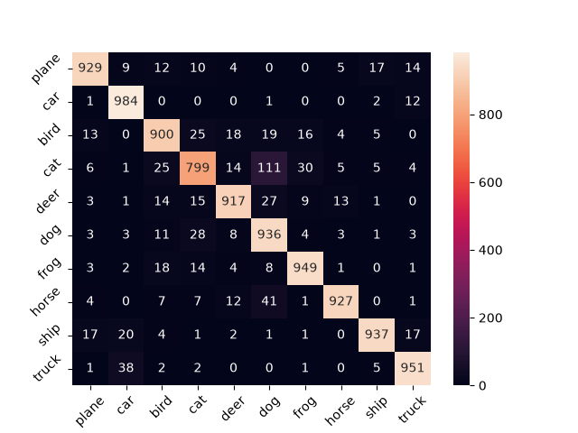

```markdown
# CIFAR-10 Custom ResNet Classification

## 📌 Project Overview
This project is a continuation of my computer vision exploration, moving from grayscale 28x28 images (Fashion-MNIST) to full-color **RGB 32x32 images (CIFAR-10)**. 

The goal was to build a robust custom ResNet architecture capable of handling natural backgrounds, color variations, and complex textures across 10 distinct classes (airplanes, cars, birds, cats, deer, dogs, frogs, horses, ships, and trucks).

## 🧠 Architecture
The model is implemented from scratch in PyTorch and features:
1. **RGB Input Handling:** First convolutional layer adapted to process 3 color channels ($3 \times 32 \times 32$).
2. **Residual Blocks:** Cascaded residual connections to allow deeper feature extraction without vanishing gradients.
3. **Data Augmentation:** Integrated random horizontal flips and random crops during training to prevent severe overfitting.
4. **Fully Connected Classifier:** Mapping extracted high-level features to 10 output classes.

## 📊 Key Findings & Visual Evidence
After training and evaluating the model, I analyzed the results to diagnose where the network excels and where it struggles:

### 1. Confusion Matrix Analysis


* **High-Accuracy Classes:** The model effortlessly recognizes rigid, distinct objects like ships, trucks, cars, and frogs, often achieving over 95% accuracy per class.
* **The Cat vs. Dog Dilemma:** Just like in real-world scenarios at this low resolution ($32 \times 32$), the hardest architectural challenge remains distinguishing between cats and dogs. The confusion matrix clearly shows a high number of mutual misclassifications between these two classes due to similar biological shapes and fur textures.

### 2. Model Prediction Grid


* **Visual Verification:** Samples from the test dataset show high-confidence correct classifications on structured objects, while occasional errors typically exhibit lower confidence scores when biological features or backgrounds mimic other classes.

## 🚀 How to Run
1. Clone this repository:
   git clone https://github.com/xcoas/CIFAR10-CNN-Classifier.git
   

```

2. Install dependencies:
```bash
pip install torch torchvision numpy matplotlib seaborn scikit-learn

```


3. Run the Jupyter Notebooks to train the model or evaluate its performance.

## 💡 Conclusion

Migrating to CIFAR-10 proved that custom residual architectures scale very well to multi-channel colored data. While raw pixel limitations at $32 \times 32$ still cap the model's ability to separate fine-grained categories (like cats and dogs), the network successfully learns to filter out background noise and extract reliable spatial features.